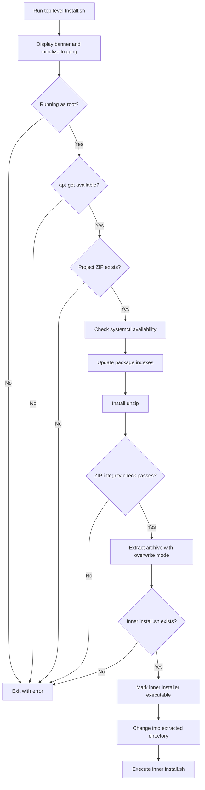

<div align="center">

# SVM V13.3 BOT

### Made by AnkitCoder

**Project distribution and Linux bootstrap installation**


[Repository](https://github.com/AnkitKing7/Svm-v13.3-bot)
•
[Installation](#installation)
•
[Security](#security)
•
[Troubleshooting](#troubleshooting)
•
[Verification Status](#verification-status)

</div>

---

> [!IMPORTANT]
> This README documents the publicly readable bootstrap installer.
> The application is distributed inside `Svm-v13.3-bot.zip`.
> Its internal source, configuration, commands, dependencies, and services
> have not been inspected for this documentation.
>
> An item marked **unverified** is not necessarily missing or unsupported.

> [!WARNING]
> The bootstrap runs with root privileges and executes an installer
> extracted from the ZIP.
> Review both installers before running them on a server.
> Start with a disposable machine rather than a production host.

## Contents

- [Overview](#overview)
- [Documentation Scope](#documentation-scope)
- [Verified Feature Inventory](#verified-feature-inventory)
- [Repository Structure](#repository-structure)
- [Architecture](#architecture)
- [Requirements](#requirements)
- [Installation](#installation)
- [Configuration](#configuration)
- [Application Feature Verification](#application-feature-verification)
- [Logging](#logging)
- [Security](#security)
- [Backup and Recovery](#backup-and-recovery)
- [Upgrades](#upgrades)
- [Troubleshooting](#troubleshooting)
- [Development and Testing](#development-and-testing)
- [Verification Status](#verification-status)
- [FAQ](#faq)
- [Contributing](#contributing)
- [License](#license)
- [Credits](#credits)

## Overview

SVM V13.3 BOT is distributed through the official repository maintained
under the `AnkitKing7` GitHub account.

The readable top-level installer identifies the project as
**SVM V13.3 BOT**, version **13.3**, and credits **AnkitCoder**.

Its role is to prepare archive extraction and delegate application setup
to the installer packaged inside the project ZIP.

The bootstrap should not be confused with the complete application
installer: the two are separate files with different capitalization.

[Source](https://raw.githubusercontent.com/AnkitKing7/Svm-v13.3-bot/main/Install.sh)

## Documentation Scope

This document distinguishes three kinds of information:

| Category | Meaning |
|---|---|
| Verified behavior | Directly observed in the readable bootstrap or repository tree |
| Operational recommendation | Suggested practice, not an implemented project feature |
| Unverified application detail | Requires inspection of files inside the application ZIP |

The inspected repository tree points to commit:

`7393576089adf3b7b1e88608717e4950fd04d648`

The tree contains two tracked files and reports that its listing is not
truncated.

[Source](https://api.github.com/repos/AnkitKing7/Svm-v13.3-bot/git/trees/main?recursive=1)

## Verified Feature Inventory

| Capability | Verified implementation |
|---|---|
| Project banner | Colored terminal banner with project and developer branding |
| Strict shell mode | `set -Eeuo pipefail` |
| Error trap | Reports the failing line and exit status |
| Root requirement | Checks `EUID` |
| Package-manager requirement | Requires `apt-get` |
| Archive availability check | Requires the ZIP in the working directory |
| Package index update | Runs `apt-get update` |
| Archive utility installation | Runs `apt-get install -y unzip` |
| Archive integrity check | Runs `unzip -tq` |
| Extraction directory | Creates `Svm-v13.3-bot` |
| Extraction | Runs `unzip -oq` |
| Inner installer check | Requires extracted `install.sh` |
| Executable permission | Applies `chmod +x` to the inner installer |
| Delegation | Replaces the bootstrap process with the inner installer |
| Logging | Sends subsequent output through `tee` |
| systemd availability check | Warns if `systemctl` is unavailable |

The presence of a `systemctl` check does not establish that a particular
service exists or that the complete application supports non-systemd hosts.

[Source](https://raw.githubusercontent.com/AnkitKing7/Svm-v13.3-bot/main/Install.sh)

## Repository Structure

### Tracked files

```text
Svm-v13.3-bot/
├── Install.sh
└── Svm-v13.3-bot.zip
```

No standalone application source, requirements file, license file, or
documentation directory appears in the inspected repository tree.

This statement concerns the tracked tree only, not the ZIP contents.

[Source](https://api.github.com/repos/AnkitKing7/Svm-v13.3-bot/git/trees/main?recursive=1)

### Paths used during bootstrap

```text
<working-directory>/
├── Install.sh
├── Svm-v13.3-bot.zip
├── logs/
│   └── bootstrap-install-YYYYMMDD-HHMMSS.log
└── Svm-v13.3-bot/
    └── install.sh
```

This is a partial runtime layout.

The inner `install.sh` is an expected archive entry, not a file verified
by inspecting the archive.

Other extracted application files are intentionally not listed.

[Source](https://raw.githubusercontent.com/AnkitKing7/Svm-v13.3-bot/main/Install.sh)

## Architecture



The diagram describes the readable bootstrap only.

It does not describe Discord, virtualization, networking, database,
or application-service architecture.

[Source](https://raw.githubusercontent.com/AnkitKing7/Svm-v13.3-bot/main/Install.sh)

## Requirements

### Bootstrap requirements

| Requirement | Details |
|---|---|
| Shell | Bash |
| Privileges | Root |
| Package manager | `apt-get` |
| Input archive | `Svm-v13.3-bot.zip` |
| Working directory | Must contain the project ZIP |
| Network access | Needed for package index updates and package installation |
| Write access | Needed for logs and extraction |

The script explicitly targets an Ubuntu/Debian environment with `apt-get`.

It does not implement distribution identification through `/etc/os-release`
or automatic selection among multiple package managers.

[Source](https://raw.githubusercontent.com/AnkitKing7/Svm-v13.3-bot/main/Install.sh)

### Requirements not yet established

The following must be determined from the application source:

- Supported Ubuntu and Debian releases.
- Minimum CPU and memory.
- Minimum free disk space.
- Supported CPU architectures.
- Required Python version.
- Python package dependencies.
- Node.js or JavaScript requirements, if any.
- Virtualization requirements.
- Required network ports.
- Service-manager requirements.
- Database requirements.

No numerical minimums are supplied here because they have not been verified.

## Installation

> [!CAUTION]
> Installation commands below are source-reviewed instructions.
> They have not been executed or validated in a disposable Ubuntu environment.
>
> Inspect the inner installer before authorizing root-level execution.

### Option A: Git checkout

On an appropriate Ubuntu/Debian test host:

```bash
sudo apt update
sudo apt install -y git unzip

git clone https://github.com/AnkitKing7/Svm-v13.3-bot
cd Svm-v13.3-bot
```

Review the bootstrap:

```bash
less Install.sh
```

Check the archive listing without extracting it:

```bash
unzip -l Svm-v13.3-bot.zip
```

Inspect the expected inner installer:

```bash
unzip -p Svm-v13.3-bot.zip install.sh | less
```

If that entry is absent, stop and inspect the archive layout.
Do not assume that a differently nested installer is equivalent.

After reviewing the code and preparing a disposable test host:

```bash
chmod +x Install.sh
sudo bash ./Install.sh
```

**Capitalization matters:** the published bootstrap is `Install.sh`,
not `install.sh`.

The lowercase filename is used for the expected installer inside the ZIP.

[Source](https://raw.githubusercontent.com/AnkitKing7/Svm-v13.3-bot/main/Install.sh)

### Option B: Application ZIP

This workflow assumes that you already obtained the exact application
archive named `Svm-v13.3-bot.zip`.

It does not describe a GitHub-generated repository source archive.

Install the extraction utility:

```bash
sudo apt update
sudo apt install -y unzip
```

Inspect and check the archive:

```bash
unzip -l Svm-v13.3-bot.zip
unzip -tq Svm-v13.3-bot.zip
```

For an initial extraction, use a new destination and avoid overwrite mode:

```bash
mkdir Svm-v13.3-bot-extracted
unzip -n Svm-v13.3-bot.zip -d Svm-v13.3-bot-extracted
cd Svm-v13.3-bot-extracted
```

Confirm that the expected installer exists and review it:

```bash
test -f install.sh
less install.sh
```

Only after inspecting the extracted application and its installer:

```bash
chmod +x install.sh
sudo bash ./install.sh
```

The expected lowercase installer path comes from the bootstrap.
Its actual archive presence and runtime behavior remain unverified.

[Source](https://raw.githubusercontent.com/AnkitKing7/Svm-v13.3-bot/main/Install.sh)

### Application ZIP versus repository ZIP

Do not treat these as interchangeable:

| Archive | Description |
|---|---|
| `Svm-v13.3-bot.zip` tracked in the repository | Application archive consumed by the bootstrap |
| ZIP downloaded through GitHub's repository download interface | Archive of the repository itself |

Inspect archive entries before deciding which directory to enter.

Do not repeatedly extract over an existing installation to resolve
an unfamiliar directory layout.

## Configuration

### Bootstrap configuration

The following are shell variables defined directly in `Install.sh`:

| Variable | Defined value or purpose |
|---|---|
| `APP_NAME` | `SVM V13.3 BOT` |
| `APP_VERSION` | `13.3` |
| `AUTHOR` | `AnkitCoder` |
| `ZIP_NAME` | `Svm-v13.3-bot.zip` |
| `PROJECT_DIR` | `Svm-v13.3-bot` |
| `LOG_DIR` | `logs` |
| `LOG_FILE` | Timestamped file beneath `logs` |

These are not documented application environment variables.

The script assigns them internally; exporting a same-named variable
before execution is not a supported override mechanism.

[Source](https://raw.githubusercontent.com/AnkitKing7/Svm-v13.3-bot/main/Install.sh)

### Environment variables

The bootstrap sets:

```text
DEBIAN_FRONTEND=noninteractive
```

This controls Debian package-installation interaction.
It is not a Discord bot credential or application configuration key.

No application `.env` schema has been verified.

Do not create an `.env.example` from guessed token, administrator,
database, provider, or network variable names.

[Source](https://raw.githubusercontent.com/AnkitKing7/Svm-v13.3-bot/main/Install.sh)

<details>
<summary><strong>Configuration review checklist</strong></summary>

Before documenting application settings:

1. Identify the actual application entry point.
2. Read its configuration-loading code.
3. Find required and optional configuration keys.
4. Record defaults only when explicitly implemented.
5. Identify configuration-file precedence.
6. Confirm missing-value behavior.
7. Check which values are secrets.
8. Identify any validation performed before startup.
9. Verify whether an existing configuration file can be overwritten.
10. Document actual examples with placeholder secrets.

These are review tasks, not claims about current implementation.

</details>

## Application Feature Verification

| Area | Documentation status |
|---|---|
| Discord commands | Unverified |
| Discord permissions | Unverified |
| Gateway intents | Unverified |
| Administrator authorization | Unverified |
| VPS lifecycle | Unverified |
| KVM/QEMU | Unverified |
| Incus/LXC | Unverified |
| IPAM | Unverified |
| Network configuration | Unverified |
| Storage management | Unverified |
| Web panel | Unverified |
| AI integration | Unverified |
| Database engine and schema | Unverified |
| Supported providers | Unverified |
| Application services | Unverified |

The bootstrap banner contains virtualization and networking labels.
Those labels do not establish feature implementation or working behavior.

No slash commands, command prefixes, service names, ports, or provider
integrations are inferred from those labels.

[Source](https://raw.githubusercontent.com/AnkitKing7/Svm-v13.3-bot/main/Install.sh)

## Logging

The bootstrap creates a relative `logs` directory and constructs a
timestamped log filename.

After logging is initialized, output is sent through:

```bash
tee -a "$LOG_FILE"
```

The banner is printed before that output redirection.

Because the inner installer is launched afterward, its normal inherited
output may also reach this log.

The bootstrap does not implement secret redaction or log rotation.

Review logs before sharing them publicly.

[Source](https://raw.githubusercontent.com/AnkitKing7/Svm-v13.3-bot/main/Install.sh)

## Security

### Root execution boundary

Treat the following as privileged operations:

- Updating system package indexes.
- Installing packages.
- Extracting project files as root.
- Changing file permissions.
- Executing the extracted installer.

The top-level bootstrap does not establish a restricted service account
or a privilege boundary for the complete application.

[Source](https://raw.githubusercontent.com/AnkitKing7/Svm-v13.3-bot/main/Install.sh)

### Archive integrity is not authenticity

The bootstrap checks ZIP integrity with `unzip -tq`.

That check does not authenticate the publisher.
The script does not verify a detached signature or an independently
trusted archive digest.

Inspect and obtain the archive through a trusted process.

[Source](https://raw.githubusercontent.com/AnkitKing7/Svm-v13.3-bot/main/Install.sh)

### Existing files can be overwritten

The bootstrap uses:

```bash
unzip -oq "$ZIP_NAME" -d "$PROJECT_DIR"
```

It does not request confirmation before overwriting matching files
during extraction.

Do not assume that an existing configuration or `.env` file is protected
if the archive contains the same relative path.

[Source](https://raw.githubusercontent.com/AnkitKing7/Svm-v13.3-bot/main/Install.sh)

### Recommended operational precautions

- Review the bootstrap and inner installer.
- Use a disposable test machine first.
- Take a server snapshot before privileged installation.
- Never commit real tokens or private keys.
- Keep application secrets out of public issue reports.
- Review logs before sharing them.
- Avoid granting permissions that have not been justified by source review.
- Do not expose management ports based on guessed defaults.
- Record the exact repository revision and archive used.
- Keep a recovery path independent of the bot.

These are recommendations, not implemented security guarantees.

## Backup and Recovery

No application-specific backup or restore procedure has been verified.

Before changing an existing deployment, identify:

- Application configuration.
- Credentials and secret storage.
- Databases and transaction requirements.
- Persistent application state.
- Managed virtual-machine or container data.
- Host network configuration.
- Service definitions.
- Storage pools and mounted volumes.

Use the discovered storage and database semantics to design a consistent
backup. A copy of the Git repository alone must not be assumed to include
runtime state.

### Bootstrap rollback limitations

The readable bootstrap has no rollback or uninstall implementation.

If an inner installer fails, the bootstrap cannot be assumed to reverse
package installation, extracted files, or inner-installer changes.

Avoid deleting the extracted project directory as a substitute for a
verified uninstall procedure.

[Source](https://raw.githubusercontent.com/AnkitKing7/Svm-v13.3-bot/main/Install.sh)

## Upgrades

No application migration or upgrade procedure has been verified.

Do not assume that rerunning the installer is a safe upgrade.

Recommended preparation:

1. Record the installed revision.
2. Back up verified persistent state.
3. Review changes to both installers.
4. Inspect the new archive contents.
5. Identify database or configuration migrations.
6. Reproduce the upgrade on a disposable copy.
7. Confirm a recovery path before production changes.

The bootstrap's overwrite-mode extraction makes blind reinstallation
particularly unsuitable as an undocumented upgrade method.

[Source](https://raw.githubusercontent.com/AnkitKing7/Svm-v13.3-bot/main/Install.sh)

## Troubleshooting

| Symptom | Verified behavior or recommended action |
|---|---|
| `install.sh: No such file or directory` in repository root | The published top-level file is `Install.sh` |
| `Root privileges are required` | Review the installers, then run the bootstrap with appropriate privileges |
| Message requiring Ubuntu/Debian with `apt-get` | The bootstrap does not support another package-manager path |
| `Cannot find Svm-v13.3-bot.zip` | Run from the directory containing the project archive |
| ZIP reported damaged or invalid | Obtain a trusted copy and investigate integrity failure |
| `Expected installer not found` | Inspect archive layout; the bootstrap expects root-level `install.sh` |
| `systemctl was not found` | A warning is issued; full application compatibility remains unverified |
| Package index update fails | Investigate repository, DNS, connectivity, and package-manager errors |
| Installation changes existing extracted files | The bootstrap uses overwrite-mode extraction |
| Application fails after delegation | Inspect the inner installer and actual application logs |
| No completed-installation summary appears | The bootstrap replaces itself with the inner installer using `exec` |

The named bootstrap error messages and delegation behavior come from the
readable script. Investigation advice is operational guidance.

[Source](https://raw.githubusercontent.com/AnkitKing7/Svm-v13.3-bot/main/Install.sh)

### Information to include in an issue

Provide:

- Repository revision.
- Operating-system release.
- Bash version.
- Installation workflow used.
- Archive filename.
- Relevant error message.
- Redacted log excerpt.
- Whether this was a fresh installation or a rerun.
- Whether extraction completed.
- Whether execution reached the inner installer.

Do not include tokens, private keys, or unredacted configuration files.

## Development and Testing

### Bootstrap syntax check

Run from the repository root:

```bash
bash -n Install.sh
```

This checks shell syntax.
It does not validate package operations or the inner installer.

### Archive integrity check

```bash
unzip -tq Svm-v13.3-bot.zip
```

This checks ZIP integrity, not application behavior.

### Extracted Python syntax check

Only after extracting and reviewing the application:

```bash
python3 -m compileall -q .
```

Run this from the extracted source directory using the application's
verified Python version.

This command may create bytecode caches.
It does not install dependencies or verify Discord connectivity.

### Suggested test matrix

| Test | What to verify |
|---|---|
| Non-root execution | Clear rejection and nonzero exit |
| Missing archive | Clear rejection before package setup |
| Corrupt archive | Integrity failure is reported |
| Missing inner installer | Expected-path error is reported |
| Unsupported package manager | Clear rejection |
| Missing `systemctl` | Warning behavior |
| Package-manager failure | Nonzero exit and useful diagnostics |
| Existing extraction directory | Overwrite behavior is understood |
| Inner installer failure | Failure status and logs are examined |
| Missing application configuration | Actual application behavior is recorded |
| Repeated installation | Configuration and state are preserved or documented |
| Disposable Ubuntu installation | End-to-end behavior is measured |

These are proposed tests.
They are not reported as executed or passed.

## Verification Status

| Activity | Status |
|---|---|
| Recursive tracked repository tree inspection | Completed |
| Top-level `Install.sh` source reading | Completed |
| Application ZIP extraction | Not performed |
| Inner installer review | Not performed |
| Python and JavaScript source review | Not performed |
| Requirements review | Not performed |
| Application configuration verification | Not performed |
| Discord command verification | Not performed |
| `bash -n Install.sh` execution | Not performed |
| Python compilation check execution | Not performed |
| Automated Markdown linting | Not performed |
| Disposable Ubuntu installation | Not performed |
| Repeated installation test | Not performed |
| Missing-configuration test | Not performed |
| Runtime failure-handling tests | Not performed |

Source inspection must not be described as runtime testing.

## FAQ

### Why does the README use `Install.sh` at the repository root?

That is the actual tracked filename.
The expected installer inside the application archive is lowercase
`install.sh`.

[Source](https://raw.githubusercontent.com/AnkitKing7/Svm-v13.3-bot/main/Install.sh)

### Can I run it from any directory?

The bootstrap uses relative paths and checks for the ZIP in the current
working directory.

Run it from the intended working directory after inspecting its contents.

[Source](https://raw.githubusercontent.com/AnkitKing7/Svm-v13.3-bot/main/Install.sh)

### Does the bootstrap create a Python virtual environment?

No virtual-environment creation appears in the readable bootstrap.

The behavior of the inner installer has not been inspected.

[Source](https://raw.githubusercontent.com/AnkitKing7/Svm-v13.3-bot/main/Install.sh)

### Does it protect an existing `.env` file?

No `.env` protection is implemented in the readable bootstrap.

Its extraction step uses overwrite mode.

[Source](https://raw.githubusercontent.com/AnkitKing7/Svm-v13.3-bot/main/Install.sh)

### Are Discord commands documented here?

No. Their definitions have not been inspected.
Publishing guessed commands would make the documentation unreliable.

### Are KVM, IPAM, or other banner features confirmed?

No. Banner text alone is not sufficient evidence of implementation.

### Is production readiness established?

No. Source visibility and runtime verification are incomplete.

## Contributing

Useful contributions include:

- Publishing application source as normal tracked files.
- Providing verified dependency declarations.
- Adding configuration examples with placeholders only.
- Documenting actual command definitions.
- Testing installation on named operating-system releases.
- Recording rerun and failure behavior.
- Adding a reviewed upgrade procedure.
- Adding a reviewed uninstall procedure.
- Clarifying licensing.

Before submitting changes:

1. Read the affected source.
2. Preserve existing working behavior.
3. Keep secrets out of commits.
4. Explain which tests were executed.
5. Distinguish observed results from assumptions.
6. Update documentation when behavior changes.

## License

No standalone license file appears in the inspected tracked repository
tree.

Licensing information inside the application archive has not been
verified.

Do not assume a particular license or reuse grant.
Ask the maintainer to clarify applicable terms.

[Source](https://api.github.com/repos/AnkitKing7/Svm-v13.3-bot/git/trees/main?recursive=1)

## Credits

**Project:** SVM V13.3 BOT  
**Developer:** AnkitCoder  
**Official repository:** https://github.com/AnkitKing7/Svm-v13.3-bot

The developer credit matches the readable bootstrap installer.

[Source](https://raw.githubusercontent.com/AnkitKing7/Svm-v13.3-bot/main/Install.sh)

---

<div align="center">

**SVM V13.3 BOT — Made by AnkitCoder**

Source-grounded documentation.
No invented commands.
No fabricated test results.

</div>
